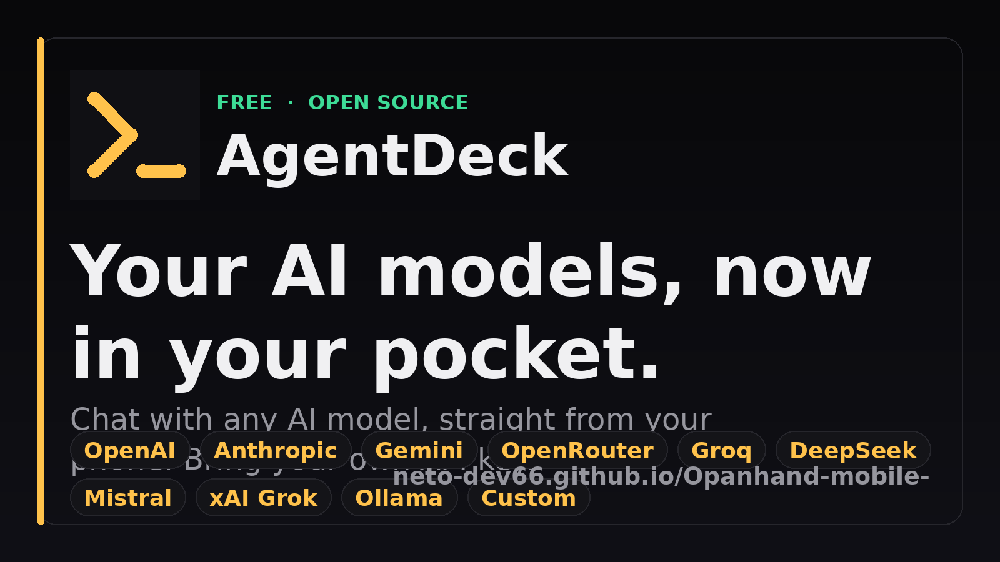
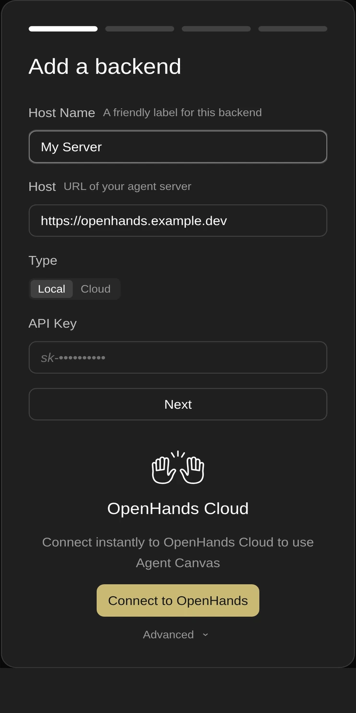
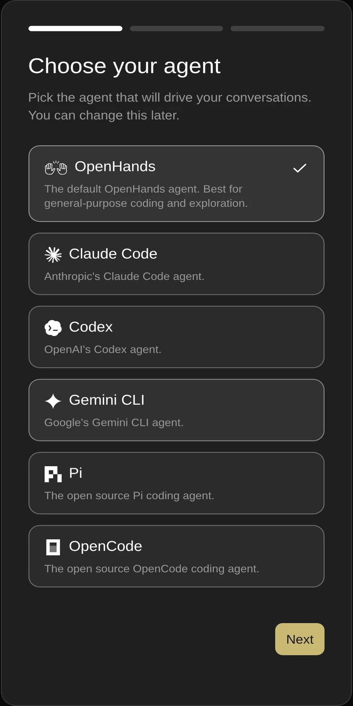
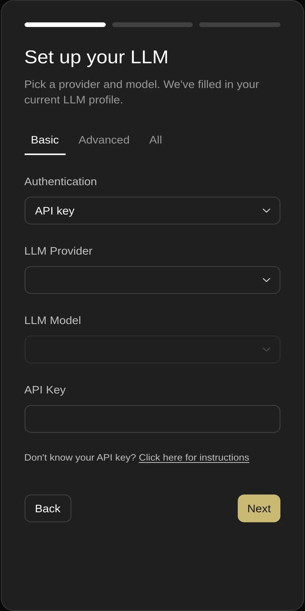
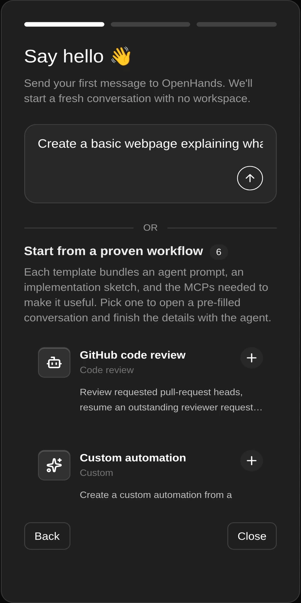

<div align="center">

# OpenHands Mobile

**The OpenHands Agent Canvas, packaged as an Android app.**

Run and supervise your AI coding agents from your phone.

[](https://neto-dev66.github.io/Opanhand-mobile-/)

[](https://github.com/NETO-DEV66/Opanhand-mobile-/releases/latest/download/app-release.apk)
[](https://neto-dev66.github.io/Opanhand-mobile-/)
[](https://github.com/NETO-DEV66/Opanhand-mobile-/releases/tag/v1.27.3)
[](https://github.com/NETO-DEV66/Opanhand-mobile-/actions/workflows/build-android-apk.yml)
[](https://github.com/NETO-DEV66/Opanhand-mobile-/blob/main/LICENSE)
[](#support-this-project)

</div>

---

## Download

**The download link below never changes.** It always serves the newest release.

| Build | Size | Link |
| --- | --- | --- |
| **Universal (signed)** | 6.2 MB | **[app-release.apk](https://github.com/NETO-DEV66/Opanhand-mobile-/releases/latest/download/app-release.apk)** |

All builds: [Releases page](https://github.com/NETO-DEV66/Opanhand-mobile-/releases)

The release is a **single universal APK** — one file that installs on every
device (arm64, armv7 and x86_64). The web bundle contains no native code, so
there is nothing to split per architecture, and there is no separate debug
build to choose between. One download works for everyone.

> **In-place updates.** Every build is signed with the same key, which the
> release workflow pins and verifies before publishing, so a new version installs
> straight over the old one — no uninstall, no lost settings. See
> [SIGNING.md](SIGNING.md) for the certificate fingerprint.

There is also a landing page with install steps and checksums:
**<https://neto-dev66.github.io/Opanhand-mobile-/>**

### Get automatic updates with Obtainium

This app is not on the Play Store. To get notified about new versions, add it to
[Obtainium](https://github.com/ImranR98/Obtainium) — a free, open-source app that
installs and updates apps straight from their GitHub releases.

[](https://apps.obtainium.imranr.dev/redirect?r=obtainium%3A%2F%2Fapp%2F%7B%22id%22%3A%22dev.openhands.agentcanvas%22%2C%22url%22%3A%22https%3A%2F%2Fgithub.com%2FNETO-DEV66%2FOpanhand-mobile-%22%2C%22author%22%3A%22NETO-DEV66%22%2C%22name%22%3A%22OpenHands%20Mobile%22%7D)

Tap the badge on your phone and Obtainium fills in the details for you. Or add
this URL by hand:

```
https://github.com/NETO-DEV66/Opanhand-mobile-
```

### Verify your download

The release APK is signed with a key that never changes. The signer fingerprint
is therefore the same for every release:

```
File:    app-release.apk
Package: dev.openhands.agentcanvas
Signer:  SHA-256 0B:05:77:B8:11:BD:3D:0E:6D:6E:F5:DA:39:07:D9:4B:91:C0:50:E6:DF:F9:7C:E1:36:0F:F5:31:40:A3:FF:47
```

The file's own size and hashes change with every build, so the release workflow
prints them and puts them in the notes on the
[releases page](https://github.com/NETO-DEV66/Opanhand-mobile-/releases) for
each version. Compare what you downloaded against that version's numbers:

```
Size:    6456058 bytes          (v1.27.3)
MD5:     2fdb058801c1f2052e5262997a8680b7
SHA-256: 9f4946ea5bc9e4f95387447aa9c7d1cbdcf8513e10ef36e57fa0be287d01fea2
```

Check it on your phone or PC:

```bash
sha256sum app-release.apk                  # Linux / macOS
certutil -hashfile app-release.apk SHA256  # Windows
```

To confirm the APK really came from this project, compare the signing
certificate above — `apksigner verify --print-certs app-release.apk`.

---

## What is OpenHands Mobile?

[OpenHands Agent Canvas](https://github.com/OpenHands/OpenHands) is a web UI for
running AI coding agents. This project wraps that web app in a native Android
shell using [Capacitor](https://capacitorjs.com/), so you can launch it, watch
runs, and approve actions from a phone.

The app contains **the same UI as the browser version** (`@openhands/agent-canvas`
v1.27.1). It is a client — it talks to an OpenHands agent server that you run
yourself, on your laptop, a server, or in the cloud.

**This is a community packaging, not an official OpenHands release.**

### Run OpenHands on Android, without a laptop

OpenHands has no official mobile app. The Agent Canvas needs Docker and Node.js,
so it does not run on a phone by itself. This project is the missing piece: it
takes the Canvas that is already running on your machine and puts a real Android
app in front of it.

If you searched for **"OpenHands Android app"**, **"OpenHands mobile"**,
**"OpenHands APK"**, or **"run OpenHands on my phone"** — this is that. You keep
the agent on real hardware, and you get the controls in your pocket.

| Question | Answer |
| --- | --- |
| Is there an official OpenHands mobile app? | No. This is an independent, community-built Android wrapper. |
| Does the agent run on the phone? | No. The agent runs on your server; the phone is the client. |
| Do I need a Play Store account? | No. You sideload the APK. |
| Is it free? | Yes — MIT licensed, no account, no telemetry. |
| Which Android versions? | 6.0 (Marshmallow, API 23) and newer. |

---

## Requirements

| Item | Value |
| --- | --- |
| Android version | 6.0 (Marshmallow, API 23) or newer |
| Architecture | Universal — arm64, armv7, x86_64 (no native code) |
| Permissions | Internet only |
| Backend | A reachable OpenHands agent server (you provide it) |

The app needs network access to your agent server. It does **not** bundle a
backend, and it does not send your data anywhere by itself.

---

## Install

> **In-place updates.** Every build is signed with the same key, which the
> release workflow pins and verifies before publishing. You can download a new
> version and install it straight over the old one — no uninstall, no lost
> settings. See [SIGNING.md](SIGNING.md) for the certificate fingerprint.

1. On your phone, open the [download link](https://github.com/NETO-DEV66/Opanhand-mobile-/releases/latest/download/app-release.apk).
2. If Android asks, allow **install from unknown sources** for your browser or
   file manager. (Settings → Apps → Special access → Install unknown apps.)
3. Open the downloaded APK and tap **Install**.
4. You may see a Play Protect warning because the app is not distributed through
   the Play Store. Tap **Install anyway**.
5. Launch **OpenHands** from your app drawer.

---

## First launch

The app does not know where your agent server lives. On first launch it shows a
four-step setup wizard:

| 1 · Connect | 2 · Pick an agent |
| :---: | :---: |
|  |  |

| 3 · Choose a model | 4 · Start working |
| :---: | :---: |
|  |  |

1. **Connect** — the address of your OpenHands agent server, for example
   `https://my-server.example.com` or `http://192.168.1.10:3000` on your home
   network. Use `https://` for anything reachable over the internet. You can
   point it at OpenHands Cloud instead and connect instantly.
2. **Pick an agent** — OpenHands by default, or bring your own Claude Code,
   Codex, Gemini CLI, Pi or OpenCode agent.
3. **Choose a model** — pick a provider and model. A sensible default is
   pre-selected.
4. **Start working** — send a first message, or open a proven workflow template
   with its prompt and MCPs already set up.

These captures come from the app with no backend attached, so every field is
blank. Your own setup will carry your server, your model and your conversations.

Your settings are stored on the device. To change them later, open
**Settings** inside the app.

> Tip: to bake the server URL into the APK so users skip this step, set the
> repository variable `BACKEND_BASE_URL` before building. See
> [Building from source](#building-from-source).

---

## Features

Everything the Agent Canvas web UI offers, adapted for a touch screen:

- **Conversations** — start a task, watch the agent work, read the diff.
- **Multiple backends** — local, remote, or cloud agent servers.
- **Agent profiles and settings** — pick the model, tools, and prompt.
- **Automations** — schedule recurring agent tasks and review their runs.
- **Skills and extensions** — manage reusable agent capabilities.
- **Files, commits, browser and terminal tabs** — inspect what the agent did.
- **MCP and LLM settings** — configure tool servers and model providers.
- **Secrets management** — store credentials for your agents.

---

## Building from source

You need Node.js 24+, JDK 21, and the Android SDK.

```bash
# 1. Get the code
git clone https://github.com/NETO-DEV66/Opanhand-mobile-.git
cd Opanhand-mobile-/OpenHands-main

# 2. Install dependencies
npm ci
npm install --no-save @capacitor/core@7 @capacitor/cli@7 @capacitor/android@7

# 3. Build the web bundle
#    Leave VITE_BACKEND_BASE_URL unset to show the in-app setup screen.
npm run build:app

# 4. Copy the web bundle into the Android project
npx cap sync android

# 5. Build the APK
cd android
./gradlew assembleRelease
```

The APK lands in `android/app/build/outputs/apk/release/app-release.apk`.

To bake in your own server URL, set it before step 3:

```bash
VITE_BACKEND_BASE_URL=https://my-server.example.com npm run build:app
```

### Signing

The signing keystore is **not** in the repository. It lives only as an
encrypted GitHub Actions secret, so the private key is never public.

The key is pinned: the release workflow compares the APK's signer against a
recorded fingerprint and **refuses to publish if it ever changes**, so users
always get an in-place update. Full detail, including the fingerprint and the
backup and rotation rules, is in [SIGNING.md](SIGNING.md).

Generate a keystore once, and keep the file backed up somewhere safe — if you
lose it you can no longer publish updates that install over the existing app:

```bash
keytool -genkey -v -keystore release.keystore -alias openhands \
  -keyalg RSA -keysize 2048 -validity 10000
```

Then add four repository secrets (Settings → Secrets and variables → Actions):

| Secret | Value |
| --- | --- |
| `ANDROID_KEYSTORE_BASE64` | `base64 -w0 release.keystore` |
| `ANDROID_KEYSTORE_PASSWORD` | the store password you chose |
| `ANDROID_KEY_PASSWORD` | the key password you chose |
| `ANDROID_KEY_ALIAS` | the alias, e.g. `openhands` |

CI writes `release.keystore` from the secret, signs, and verifies the result.
A local build reads the same names from the environment:

```bash
export OPENHANDS_KEYSTORE_PASSWORD=...
export OPENHANDS_KEY_PASSWORD=...
export OPENHANDS_KEY_ALIAS=openhands
# drop release.keystore at OpenHands-main/android/app/release.keystore
```

Never commit the keystore. `.gitignore` already excludes `*.keystore` and `*.jks`.

#### Keystore backup and recovery

The private key exists in exactly two places: the GitHub Actions secret, and a
local backup you keep yourself. If both are lost, you can never publish an
update that installs over the existing app — users would have to uninstall
first, and Android would treat the new build as a different app.

Keep the backup **outside** this repository and never serve it from a web
directory. A safe backup bundle contains:

| File | Why |
| --- | --- |
| `release.keystore` | the private key itself |
| `release-cert.pem` | the public certificate, for verification |
| `CREDENTIALS.txt` | the alias and the two passwords |
| `CHECKSUMS.txt` | SHA-256 of the keystore, to detect corruption |

Store that bundle in a password manager, an encrypted archive, or offline
media. To check a backup is still valid and matches the published app:

```bash
keytool -list -keystore release.keystore -storetype PKCS12 \
  -storepass "$STORE_PASSWORD" | grep -i privatekeyentry

# fingerprint must match the certificate the published APK was signed with
keytool -printcert -jarfile app-release.apk | grep SHA256
keytool -printcert -file release-cert.pem | grep SHA256
```

To rebuild a lost GitHub secret from a backup:

```bash
base64 -w0 release.keystore   # paste into ANDROID_KEYSTORE_BASE64
```

If the keystore is genuinely gone, generate a new one, bump the version, and
tell users to uninstall the old app before installing the new build.

---

## Continuous integration

The workflow at
[`.github/workflows/build-android-apk.yml`](.github/workflows/build-android-apk.yml)
builds the APK on every push to `main`, and on every version tag it signs the
release APK with the secret key and attaches it to the GitHub Release.

### Cutting a new release

1. Bump `versionCode` and `versionName` in
   `OpenHands-main/android/app/build.gradle`.
2. Commit, then tag and push:

```bash
git tag v1.28.0
git push origin v1.28.0
```

GitHub Actions builds and publishes the APK. The `releases/latest/download`
links then point at the new version automatically — no documentation to update.
The publish step only runs when the keystore secret is present, so an unsigned
APK can never be released by accident.

### Optional repository settings

| Name | Type | Purpose |
| --- | --- | --- |
| `BACKEND_BASE_URL` | Variable | Bakes the agent server URL into the app. |
| `SIGNING_CERT_SHA256` | Variable | **Set.** The pinned signer fingerprint. The workflow refuses to publish an APK signed with anything else, and fails closed if it cannot read the fingerprint at all. Change it only when rotating the key on purpose. |
| `ANDROID_KEYSTORE_BASE64` | Secret | The signing keystore, base64-encoded. Required to publish. |
| `ANDROID_KEYSTORE_PASSWORD` | Secret | Keystore store password. |
| `ANDROID_KEY_PASSWORD` | Secret | Keystore key password. |
| `ANDROID_KEY_ALIAS` | Secret | Keystore key alias. |

---

## Troubleshooting

| Problem | Fix |
| --- | --- |
| "App not installed" | You probably have a copy signed by a different key (an older build from another source). Uninstall that one, then install this APK. Builds from this repo's own releases always install in place. |
| Play Protect blocks install | Tap **Install anyway**; the APK is not from the Play Store. |
| App opens but cannot connect | Check the server URL and that the phone can reach it. Use `https://` for remote servers. |
| Stuck on the loading screen | Confirm the agent server is running, then reopen the app. |
| Blank screen after an update | Clear app data in Android settings and reconnect. |

---

## Support this project

This app is **free and open source**, and it always will be. You do not have to
pay anything to download it, use it, or modify it.

That said, if this project saved you some time and you feel like saying thanks,
a small contribution is genuinely appreciated. It goes towards keeping the build
pipeline running and putting more time into improvements.

### Pay via UPI (India)

| | |
| --- | --- |
| **UPI ID** | `mrsameer1906@okhdfcbank` |
| **Name** | Sameer |

Scan the QR code with any UPI app — GPay, PhonePe, Paytm, BHIM, or your bank's
app — and the payment details fill in automatically:

<div align="center">


</div>

**Or copy this UPI ID** into the "Pay to UPI ID" field of your UPI app:

```
mrsameer1906@okhdfcbank
```

No amount is suggested and nothing is expected. Give only if you want to, and
only what you are comfortable with. Thank you either way.

### Other ways to help (free)

Not everyone can or should send money. These help just as much:

- **Star this repository** so more people can find it.
- **Report a bug** or suggest an improvement in
  [Issues](https://github.com/NETO-DEV66/Opanhand-mobile-/issues).
- **Tell someone** who would find a mobile OpenHands client useful.
- **Contribute** a fix or a feature through a pull request.

---

## Credits and license

**All credit for the application belongs to the OpenHands project.**

- The app is [OpenHands Agent Canvas](https://github.com/OpenHands/OpenHands),
  built by **All Hands AI** and its contributors, and released under the MIT
  license. The interface, the agent canvas and everything inside the app are
  their work.
- The launcher icon and logo are the **official OpenHands artwork**, used
  unchanged (the yellow mark on white). No custom branding is applied.
- This repository only adds the Android packaging (Capacitor wrapper, icons,
  splash screen) and the build pipeline. Packaged and maintained by **Sameer**
  ([@NETO-DEV66](https://github.com/NETO-DEV66)).
- The Android wrapper is released under the MIT license as well.

This project is not affiliated with or endorsed by the OpenHands team or All
Hands AI. If you want the official product, see
<https://github.com/OpenHands/OpenHands>.

---

<div align="center">

**[Download the latest APK](https://github.com/NETO-DEV66/Opanhand-mobile-/releases/latest/download/app-release.apk)**

If it helped you, you can [buy me a chai ☕](#support-this-project) — but only if you want to.

</div>
