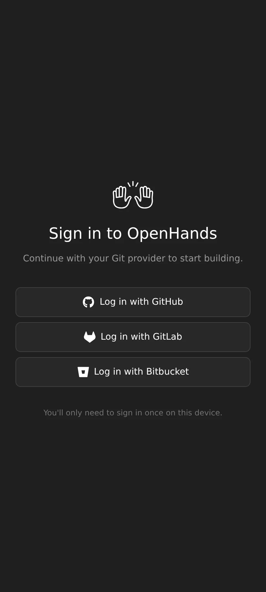

<div align="center">

# OpenHands Mobile

**The OpenHands Agent Canvas, packaged as an Android app.**

Run and supervise your AI coding agents from your phone.

> **Unofficial community build.** This is an independent packaging of
> [OpenHands Agent Canvas](https://github.com/OpenHands/OpenHands), not an
> official OpenHands release, and it is not affiliated with or endorsed by All
> Hands AI. It ships its own name, icon and package id for that reason. All
> credit for the app itself belongs to the OpenHands project — see
> [Credits and license](#credits-and-license).

[](https://neto-dev66.github.io/Opanhand-mobile-/)

[](https://github.com/NETO-DEV66/Opanhand-mobile-/releases/latest/download/app-release.apk)
[](https://neto-dev66.github.io/Opanhand-mobile-/)
[](https://github.com/NETO-DEV66/Opanhand-mobile-/releases/tag/v1.32.6)
[](https://github.com/NETO-DEV66/Opanhand-mobile-/actions/workflows/build-android-apk.yml)
[](https://github.com/NETO-DEV66/Opanhand-mobile-/blob/main/LICENSE)
[](#support-this-project)

</div>

---

## Download

**The download link below never changes.** It always serves the newest release.

| Build | Size | Link |
| --- | --- | --- |
| **Universal (signed)** | 5.9 MB | **[app-release.apk](https://github.com/NETO-DEV66/Opanhand-mobile-/releases/latest/download/app-release.apk)** |

All builds: [Releases page](https://github.com/NETO-DEV66/Opanhand-mobile-/releases)

The release is a **single universal APK** — one file that installs on every
device (arm64, armv7 and x86_64). The web bundle contains no native code, so
there is nothing to split per architecture, and there is no separate debug
build to choose between. One download works for everyone.

> **Updating from v1.28.3 or earlier?** Uninstall that build first. v1.30.0
> changed the package id to `dev.openhandsmobile.com`, so Android treats it as
> a new app. Every release is signed with the same key, so from v1.30.0 onward
> builds install straight over each other — no uninstall, no lost settings. See
> [SIGNING.md](SIGNING.md) for the certificate fingerprint.

There is also a landing page with install steps and checksums:
**<https://neto-dev66.github.io/Opanhand-mobile-/>**

### Get automatic updates with Obtainium

This app is not on the Play Store. To get notified about new versions, add it to
[Obtainium](https://github.com/ImranR98/Obtainium) — a free, open-source app that
installs and updates apps straight from their GitHub releases.

[](https://apps.obtainium.imranr.dev/redirect?r=obtainium%3A%2F%2Fapp%2F%7B%22id%22%3A%22dev.openhandsmobile.com%22%2C%22url%22%3A%22https%3A%2F%2Fgithub.com%2FNETO-DEV66%2FOpanhand-mobile-%22%2C%22author%22%3A%22NETO-DEV66%22%2C%22name%22%3A%22OpenHands%20Mobile%22%7D)

Tap the badge on your phone and Obtainium fills in the details for you. Or add
this URL by hand:

```
https://github.com/NETO-DEV66/Opanhand-mobile-
```

### Verify your download

The release APK is signed with a key that never changes. The signer fingerprint
is therefore the same for every release:

```
File:    app-release.apk
Package: dev.openhandsmobile.com
Signer:  SHA-256 0B:05:77:B8:11:BD:3D:0E:6D:6E:F5:DA:39:07:D9:4B:91:C0:50:E6:DF:F9:7C:E1:36:0F:F5:31:40:A3:FF:47
```

The file's own size and hashes change with every build, so the release workflow
prints them and puts them in the notes on the
[releases page](https://github.com/NETO-DEV66/Opanhand-mobile-/releases) for
each version. Compare what you downloaded against that version's numbers:

```
Size:    <printed in the release notes>
MD5:     <printed in the release notes>
SHA-256: <printed in the release notes>
```

Check it on your phone or PC:

```bash
sha256sum app-release.apk                  # Linux / macOS
certutil -hashfile app-release.apk SHA256  # Windows
```

To confirm the APK really came from this project, compare the signing
certificate above — `apksigner verify --print-certs app-release.apk`.

---

## What is OpenHands Mobile?

[OpenHands Agent Canvas](https://github.com/OpenHands/OpenHands) is a web UI for
running AI coding agents. This project wraps that web app in a native Android
shell using [Capacitor](https://capacitorjs.com/), so you can launch it, watch
runs, and approve actions from a phone.

The app contains **the same UI as the browser version** (`@openhands/agent-canvas`
v1.27.1). The shipped build is a **client of OpenHands Cloud**: on first launch
you sign in with GitHub, GitLab or Bitbucket, and the agent runs on the server.
A **standalone** build that runs the agent runtime on the phone and calls your
own LLM provider is also available.

**This is a community packaging, not an official OpenHands release.**

### OpenHands on Android

OpenHands has no official mobile app, and the full Agent Canvas needs Docker and
Node.js, so it does not run on a phone by itself. This project ships a mobile
build that signs you in to OpenHands Cloud and lets you run and watch agents from
the phone. No Docker, no laptop in the loop.

If you searched for **"OpenHands Android app"**, **"OpenHands mobile"**,
**"OpenHands APK"**, or **"run OpenHands on my phone"** — this is that.

| Question | Answer |
| --- | --- |
| Is there an official OpenHands mobile app? | No. This is an independent, community-built Android wrapper. |
| Does the agent run on the phone? | No, in the shipped build — it runs on OpenHands Cloud and the phone is the client. The standalone build runs the agent on the phone instead. |
| Do I need a Play Store account? | No. You sideload the APK. |
| Do I need an OpenHands Cloud account? | Yes, for the shipped build — sign in with GitHub, GitLab or Bitbucket on first launch. The standalone build needs only an LLM provider API key instead. |
| Is it free? | Yes — MIT licensed, no telemetry. |
| Which Android versions? | 6.0 (Marshmallow, API 23) and newer. |

---

## Requirements

| Item | Value |
| --- | --- |
| Android version | 6.0 (Marshmallow, API 23) or newer |
| Architecture | Universal — arm64, armv7, x86_64 (no native code) |
| WebView | Android System WebView 76 or newer (Chrome 76+). Older WebViews cannot parse the app bundle and show an update prompt instead of the UI. |
| Permissions | Internet only |
| Backend | OpenHands Cloud, reached by signing in with GitHub, GitLab or Bitbucket. A standalone build that runs the agent on the phone is available (see [Standalone mode](#standalone-mode)). |
| Telemetry | None. The APK is built with `VITE_DO_NOT_TRACK=1`, so the upstream PostHog client is disabled at compile time and never initialised. |

The shipped app needs network access to OpenHands Cloud and nothing else.
The standalone build needs network access to your LLM provider. Neither sends
your data anywhere by itself.

---

## Install

> **Updating from v1.28.3 or earlier?** Uninstall that build once. v1.30.0
> changed the package id, so Android sees it as a new app. Releases from
> v1.30.0 onward install straight over each other — no uninstall, no lost
> settings. See [SIGNING.md](SIGNING.md) for the fingerprint.

1. On your phone, open the [download link](https://github.com/NETO-DEV66/Opanhand-mobile-/releases/latest/download/app-release.apk).
2. If Android asks, allow **install from unknown sources** for your browser or
   file manager. (Settings → Apps → Special access → Install unknown apps.)
3. Open the downloaded APK and tap **Install**.
4. You may see a Play Protect warning because the app is not distributed through
   the Play Store. Tap **Install anyway**.
5. Launch **OpenHands Mobile** from your app drawer.

---

## First launch

The shipped build is a **client of OpenHands Cloud**. The first screen is a
sign-in: tap your Git provider and finish the login in the browser that opens.
You land in your workspace.



1. **Tap a provider** — Log in with GitHub, GitLab or Bitbucket.
2. **Approve in the browser** — the phone shows a short code; the provider page
   opens and you confirm. You only do this once per device.
3. **Start working** — you land in your workspace and can run and watch agents.

> **Standalone build.** To run the agent on the phone and call your own LLM
> provider instead, leave the repository variable `STANDALONE_MODE` unset (or
> set it to `true`). First launch is then the agent picker, a model, and your
> provider API key. See [Standalone mode](#standalone-mode).

---

## Standalone mode

The standalone build (`STANDALONE_MODE` unset or `true`) answers the agent-server
REST and WebSocket API from inside the app (`OpenHands-main/src/local-runtime/`)
and calls your LLM provider directly, so no server is involved. Two things follow
from that:

- **Your API key stays on the device.** It is written to the app's
  `localStorage` and sent only to the provider you configured. Nothing is
  proxied anywhere.
- **A service worker is not required.** Some Android WebViews cannot register
  one. When registration fails the app answers the same mock REST handlers from
  inside the page instead of rendering against an unmocked `fetch`.
- **Old WebViews are covered.** The bundle is transpiled to ES2019 and a small
  ES5 prelude (`public/legacy-polyfills.js`) supplies the runtime globals a
  modern Chrome has and an older WebView does not (`TransformStream`,
  `TextEncoderStream`, `structuredClone`, `Object.hasOwn`, `Array.prototype.at`,
  `String.prototype.replaceAll`).
  If the WebView is too old even for module scripts, the prelude shows an update
  prompt rather than a black screen. `node scripts/verify-old-webview.mjs`
  checks this against a real browser with those globals removed.
- **`TransformStream` is the one that bites.** The platform added
  `ReadableStream` and `WritableStream` in Chrome 43 but `TransformStream` only
  in Chrome 67, so an Android 6–8 WebView (which `minSdk 23` admits) has the
  native streams and no `TransformStream`. That is worse than simply missing: the
  bundle has `class extends TransformStream` at module scope and the inline
  bootstrap pipes through `TextEncoderStream`, which the prelude builds on
  `TransformStream`. Both throw before React mounts, the console stays empty, and
  the user sees a black screen. The prelude therefore defines `TransformStream`
  itself, on the native `ReadableStream`/`WritableStream` (native `pipeThrough`
  brand-checks its argument and would reject a fully polyfilled stream). This was
  the shipped v1.32.4 fix; v1.32.2 and v1.32.3 both shipped without it.
- **The prelude must stay ES5.** It is loaded as a classic script before every
  module, so on an old WebView it is the only code that can run at all. ES2015+
  syntax in it is not a partial failure: the WebView discards the whole file, the
  `TextEncoderStream` shim never installs, react-router's inline bootstrap throws
  and the app shows a black screen. Prettier's defaults (`trailingComma: "all"`,
  `arrowParens: "always"`) rewrite it with ES2017 syntax, so the file is listed in
  `.prettierignore`, and `npm run check:prelude` (part of `build:app` and `lint`)
  fails the build if it is not pure ES5.
- **The chunks have a syntax floor too.** `npm run check:bundle-syntax` (also in
  `build:app`) parses the build output and fails on any app chunk needing syntax
  above ES2019 (Chrome 76) — optional chaining, nullish coalescing, logical
  assignment. Those cannot be shimmed at runtime, so a chunk that contains one
  black-screens the same way. The generated mock service worker is reported as a
  warning only, since the app falls back in-process when it cannot run.
- **The stylesheet has a floor, and it is the one that bites hardest.**
  Tailwind v4 emits every rule inside `@layer`, and cascade layers are Chrome 99.
  An older WebView does not know the at-rule, and CSS says to drop an unknown
  at-rule together with its whole block — so the entire stylesheet contributes
  nothing. Unlike the JavaScript failures above this one is *silent even to the
  prelude*: the app still mounts, `document.body.innerText` is non-empty, so the
  blank-page watchdog reads the page as fine and shows no notice. The user gets a
  black screen and no explanation. `npm run flatten:css` (in `build:app`) unwraps
  every `@layer` block before `cap sync`, and `npm run check:css-compat` fails the
  build if one reappears. This was the shipped v1.32.4 state: its APK carried
  five `@layer` blocks, which is why "the notice never appears" on real devices
  even though the ES5 prelude ran correctly.
- **Startup cannot hang.** `prepareApp()` races an 8 s deadline in
  `src/entry.client.tsx`, so a request that never settles (i18n locale fetch on a
  captive portal, say) still renders the app instead of leaving it blank.
- **The blank-page watchdog must not become the black screen.** The prelude's
  watchdog shows a full-screen notice when nothing has rendered, and that notice
  has a near-black background — so a notice left up over a working app looks
  exactly like the black screen it exists to explain. A slow device (a cold
  emulator, a low-end phone) can take well over the 20 s threshold to paint, and
  the notice used to be one-shot and permanent: it would appear at 20 s and stay
  up over an app that rendered at 60 s. The watchdog now keeps watching after it
  shows the notice and removes it as soon as the app's own text appears. The
  blank check also subtracts the notice's own text, since `body.innerText`
  includes it and would otherwise read the warning as proof the app rendered.
  This was the shipped v1.32.5 state on a WebView 83 emulator: CSS fixed (2774
  rules, layout restored) but the app sat under a stale notice.

The runtime only exists in the standalone build (`VITE_MOCK_API=true`, i.e.
`STANDALONE_MODE` unset or `true`). The shipped Cloud client is byte-for-byte
the upstream client: no local runtime, no mock handlers, no `localStorage`
conversation store.

| Repository variable | Cloud client (shipped) | Standalone |
| --- | --- | --- |
| `STANDALONE_MODE` | `false` | unset or anything but `false` |
| `BACKEND_BASE_URL` | baked in as the Cloud API URL | ignored |
| `CLOUD_BASE_URL` | Cloud host to lock to, or `off` to ship unlocked | ignored |

With `STANDALONE_MODE=false` the build is locked to OpenHands Cloud
(`VITE_LOCK_TO_CLOUD`), which is what makes first launch the GitHub/GitLab/
Bitbucket sign-in rather than the agent/LLM onboarding. Leaving `CLOUD_BASE_URL`
unset locks to hosted Cloud (`https://app.all-hands.dev`); set it to another
origin for a self-hosted Cloud, or to `off` to ship the unlocked build.

---

## Features

Everything the Agent Canvas web UI offers, adapted for a touch screen:

- **Conversations** — start a task, watch the agent work, read the diff.
- **Multiple backends** — connect to any number of agent servers you run.
- **Agent profiles and settings** — pick the model, tools, and prompt.
- **Automations** — schedule recurring agent tasks and review their runs.
- **Skills and extensions** — manage reusable agent capabilities.
- **Files, commits, browser and terminal tabs** — inspect what the agent did.
- **MCP and LLM settings** — configure tool servers and model providers.
- **Secrets management** — store credentials for your agents.

---

## Building from source

You need Node.js 24+, JDK 21, and the Android SDK.

```bash
# 1. Get the code
git clone https://github.com/NETO-DEV66/Opanhand-mobile-.git
cd Opanhand-mobile-/OpenHands-main

# 2. Install dependencies
npm ci
npm install --no-save @capacitor/core@7 @capacitor/cli@7 @capacitor/android@7

# 3. Build the web bundle
#    The shipped build is the OpenHands Cloud client (locked to Cloud, so first
#    launch is the Git-provider sign-in). For the standalone build instead, use:
#    VITE_MOCK_API=true npm run build:app
VITE_MOCK_API=false VITE_BACKEND_BASE_URL=https://app.all-hands.dev VITE_LOCK_TO_CLOUD=https://app.all-hands.dev npm run build:app

# 4. Copy the web bundle into the Android project
npx cap sync android

# 5. Build the APK
cd android
./gradlew assembleRelease
```

The APK lands in `android/app/build/outputs/apk/release/app-release.apk`.

The shipped Cloud client turns the mock API off and locks to Cloud, which is
what shows the sign-in on first launch:

```bash
VITE_MOCK_API=false VITE_BACKEND_BASE_URL=https://app.all-hands.dev VITE_LOCK_TO_CLOUD=https://app.all-hands.dev npm run build:app
```

The standalone build turns the mock API on, which is what installs the local
runtime:

```bash
VITE_MOCK_API=true npm run build:app
```

### Running the tests

The web app has a Vitest suite (unit and component tests). It runs in two
projects: DOM-free suites in a fast Node environment, everything else in jsdom
with the shared MSW handlers answering network calls.

```bash
npm test              # one-shot run
npm run test:watch    # re-run on change
npm run test:coverage # with a coverage report
```

Type-checking and linting are separate:

```bash
npm run typecheck
npm run lint
```

### Signing

The signing keystore is **not** in the repository. It lives only as an
encrypted GitHub Actions secret, so the private key is never public.

The key is pinned: the release workflow compares the APK's signer against a
recorded fingerprint and **refuses to publish if it ever changes**, so users
always get an in-place update. Full detail, including the fingerprint and the
backup and rotation rules, is in [SIGNING.md](SIGNING.md).

Generate a keystore once, and keep the file backed up somewhere safe — if you
lose it you can no longer publish updates that install over the existing app:

```bash
keytool -genkey -v -keystore release.keystore -alias openhands \
  -keyalg RSA -keysize 2048 -validity 10000
```

Then add four repository secrets (Settings → Secrets and variables → Actions):

| Secret | Value |
| --- | --- |
| `ANDROID_KEYSTORE_BASE64` | `base64 -w0 release.keystore` |
| `ANDROID_KEYSTORE_PASSWORD` | the store password you chose |
| `ANDROID_KEY_PASSWORD` | the key password you chose |
| `ANDROID_KEY_ALIAS` | the alias, e.g. `openhands` |

CI writes `release.keystore` from the secret, signs, and verifies the result.
A local build reads the same names from the environment:

```bash
export OPENHANDS_KEYSTORE_PASSWORD=...
export OPENHANDS_KEY_PASSWORD=...
export OPENHANDS_KEY_ALIAS=openhands
# drop release.keystore at OpenHands-main/android/app/release.keystore
```

Never commit the keystore. `.gitignore` already excludes `*.keystore` and `*.jks`.

#### Keystore backup and recovery

The private key exists in exactly two places: the GitHub Actions secret, and a
local backup you keep yourself. If both are lost, you can never publish an
update that installs over the existing app — users would have to uninstall
first, and Android would treat the new build as a different app.

Keep the backup **outside** this repository and never serve it from a web
directory. A safe backup bundle contains:

| File | Why |
| --- | --- |
| `release.keystore` | the private key itself |
| `release-cert.pem` | the public certificate, for verification |
| `CREDENTIALS.txt` | the alias and the two passwords |
| `CHECKSUMS.txt` | SHA-256 of the keystore, to detect corruption |

Store that bundle in a password manager, an encrypted archive, or offline
media. To check a backup is still valid and matches the published app:

```bash
keytool -list -keystore release.keystore -storetype PKCS12 \
  -storepass "$STORE_PASSWORD" | grep -i privatekeyentry

# fingerprint must match the certificate the published APK was signed with
keytool -printcert -jarfile app-release.apk | grep SHA256
keytool -printcert -file release-cert.pem | grep SHA256
```

To rebuild a lost GitHub secret from a backup:

```bash
base64 -w0 release.keystore   # paste into ANDROID_KEYSTORE_BASE64
```

If the keystore is genuinely gone, generate a new one, bump the version, and
tell users to uninstall the old app before installing the new build.

---

## Continuous integration

The workflow at
[`.github/workflows/build-android-apk.yml`](.github/workflows/build-android-apk.yml)
builds the APK on every push to `main`, and on every version tag it signs the
release APK with the secret key and attaches it to the GitHub Release.

### Cutting a new release

1. Bump `versionCode` and `versionName` in
   `OpenHands-main/android/app/build.gradle`.
2. Commit, then tag and push:

```bash
git tag v1.32.6
git push origin v1.32.6
```

GitHub Actions builds and publishes the APK. The `releases/latest/download`
links then point at the new version automatically — no documentation to update.
The publish step only runs when the keystore secret is present, so an unsigned
APK can never be released by accident.

### Optional repository settings

| Name | Type | Purpose |
| --- | --- | --- |
| `STANDALONE_MODE` | Variable | **Set to `false`.** Ships the OpenHands Cloud client: first launch is the GitHub/GitLab/Bitbucket sign-in. Unset (or `true`) ships the standalone app instead — no server, first launch is the agent/LLM steps. |
| `CLOUD_BASE_URL` | Variable | Cloud client only. The Cloud origin the app is locked to; unset means hosted OpenHands Cloud (`https://app.all-hands.dev`). Set it to another origin for a self-hosted Cloud, or to `off` to ship the unlocked build (backend form on first launch). |
| `BACKEND_BASE_URL` | Variable | Cloud client only. Bakes the Cloud API URL into the app. |
| `SIGNING_CERT_SHA256` | Variable | **Set.** The pinned signer fingerprint. The workflow refuses to publish an APK signed with anything else, and fails closed if it cannot read the fingerprint at all. Change it only when rotating the key on purpose. |
| `ANDROID_KEYSTORE_BASE64` | Secret | The signing keystore, base64-encoded. Required to publish. |
| `ANDROID_KEYSTORE_PASSWORD` | Secret | Keystore store password. |
| `ANDROID_KEY_PASSWORD` | Secret | Keystore key password. |
| `ANDROID_KEY_ALIAS` | Secret | Keystore key alias. |

---

## Troubleshooting

| Problem | Fix |
| --- | --- |
| "App not installed" | You have a copy signed by a different key, or the pre-1.28.0 build with the old package id. Uninstall that one, then install this APK. Releases from v1.28.0 onward always install in place. |
| Play Protect blocks install | Tap **Install anyway**; the APK is not from the Play Store. |
| "Your LLM isn't set up yet" | Open **Settings → LLM**, pick a provider and model, and paste an API key. |
| The agent replies with a provider error | The API key is wrong, or the provider rejected the request. The message names the provider's reason. |
| A provider that is not in the list fails | Set a **base URL** to an OpenAI-compatible endpoint (Ollama, vLLM, llama.cpp). |
| Server-backed build cannot connect | Check `BACKEND_BASE_URL` and that the phone can reach the server. Use `https://` for remote servers. |
| Blank screen after an update | Clear app data in Android settings and set the model up again. |

---

## Support this project

This app is **free and open source**, and it always will be. You do not have to
pay anything to download it, use it, or modify it.

That said, if this project saved you some time and you feel like saying thanks,
a small contribution is genuinely appreciated. It goes towards keeping the build
pipeline running and putting more time into improvements.

### Pay via UPI (India)

| | |
| --- | --- |
| **UPI ID** | `mrsameer1906@okhdfcbank` |
| **Name** | Sameer |

Scan the QR code with any UPI app — GPay, PhonePe, Paytm, BHIM, or your bank's
app — and the payment details fill in automatically:

<div align="center">


</div>

**Or copy this UPI ID** into the "Pay to UPI ID" field of your UPI app:

```
mrsameer1906@okhdfcbank
```

No amount is suggested and nothing is expected. Give only if you want to, and
only what you are comfortable with. Thank you either way.

### Other ways to help (free)

Not everyone can or should send money. These help just as much:

- **Star this repository** so more people can find it.
- **Report a bug** or suggest an improvement in
  [Issues](https://github.com/NETO-DEV66/Opanhand-mobile-/issues).
- **Tell someone** who would find a mobile OpenHands client useful.
- **Contribute** a fix or a feature through a pull request.

---

## Credits and license

**All credit for the application belongs to the OpenHands project.**

- The app is [OpenHands Agent Canvas](https://github.com/OpenHands/OpenHands),
  built by **All Hands AI** and its contributors, and released under the MIT
  license. The interface, the agent canvas and everything inside the app are
  their work.
- The launcher icon, splash screen and the "OpenHands Mobile" name are this
  project's own. The official OpenHands artwork is **not** used, so that the
  unofficial nature of this build is obvious at a glance.
- This repository only adds the Android packaging: the Capacitor wrapper, the
  app's own icon and splash, and the build pipeline. Packaged and maintained by
  **Sameer** ([@NETO-DEV66](https://github.com/NETO-DEV66)).
- The Android wrapper is released under the MIT license as well.

This project is not affiliated with or endorsed by the OpenHands team or All
Hands AI. If you want the official product, see
<https://github.com/OpenHands/OpenHands>.

---

<div align="center">

**[Download the latest APK](https://github.com/NETO-DEV66/Opanhand-mobile-/releases/latest/download/app-release.apk)**

If it helped you, you can [buy me a chai ☕](#support-this-project) — but only if you want to.

</div>
